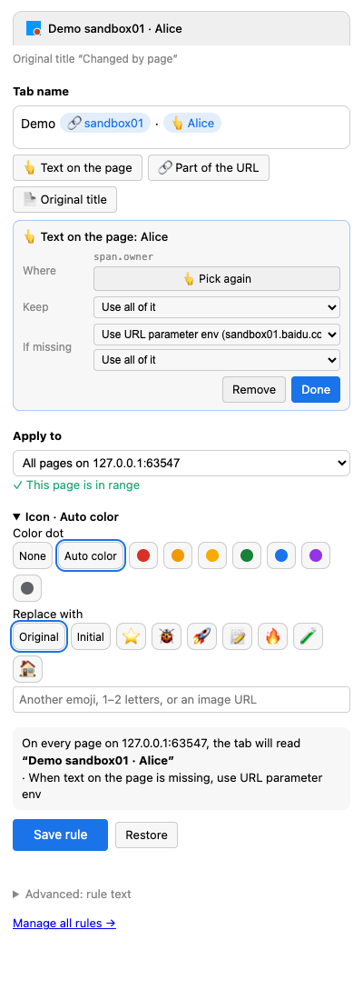

# Telltab

**English** · [简体中文](README.zh-CN.md)

A Chrome extension that renames tabs and recolors their icons. A tab name can mix your own text, text from the page, any part of the URL and the original title, and every piece can fall back to something else while the page is still loading. URL matching uses zsh / `zmv` style globs or regular expressions.

```text
# URL  http://host/app?id=3&env=sandbox01.baidu.com   →  tab "sandbox01", one stable color per env
*[?&]env=(*).baidu.com* => {1} ; color=auto
```



## Why

When ten tabs all say "Dashboard" or "Order detail", you cannot tell the QA environment from production, or one ticket from another. Telltab puts the part you care about into the tab title: the environment from the URL, the ticket number from the page, a fixed label for one tab.

## Install

Telltab is not in the Chrome Web Store yet. Install it from a release:

1. Download `telltab-<version>.zip` from [Releases](https://github.com/commiyou/telltab/releases) and unzip it (or clone this repo).
2. Open `chrome://extensions` and turn on **Developer mode** (top right).
3. Click **Load unpacked** and choose the unzipped folder.

Needs Chrome 116 or later. To update, unzip the new release over the old folder and click the reload button on the extension's card; then reload tabs that were already open.

## Use it in one minute

1. Open any page and click the Telltab icon (or press `Alt+Shift+R`). A side panel opens.
2. Type a name in **Tab name**. Or insert pieces: **👆 Text on the page** (then click the text), **🔗 Part of the URL** (then click a part), **📄 Original title**.
3. Click a piece to keep only part of it (before or after a `.`, or a regex), and to choose what to show **if missing**.
4. Pick where it applies: this tab only, this site, this path, or any URL with a given parameter.
5. Click **Save rule**. The preview at the top shows the tab before you save.

The [tutorial](docs/tutorial.md) walks through five real examples with screenshots.

## Rule text

Everything the panel saves is one line of text. You can edit, copy and share rules on the rules page (right-click the icon → Options):

```text
URL match => tab name [; icon=…] [; color=…]
```

```text
*://*.baidu.com/*        => {?env before "."}                                # a URL parameter
*://*.baidu.com/*        => [{page ".env-name" or ?env before "."}] {title}   # page text, URL while loading
*://jira.x/browse/*      => {page "h1" match /([A-Z]+-\d+)/ or path[2]} ; icon=🐞
```

| In the tab name | Means |
| --- | --- |
| `{page ".css"}` | text of the first matching element on the page |
| `{?env}` `{host[1]}` `{path[2]}` | URL parameter, domain part, path part |
| `{title}` `{1}` | original title, first `(*)` of the URL match |
| `A or B or "text"` | use the next one when a piece is empty |
| `before "."` `after "-"` `match /re/` | keep only part of a piece |

The full syntax is in the [tutorial](docs/tutorial.md#5-rule-text) and on the rules page.

## Privacy

Telltab has no server and sends nothing anywhere. Rules are stored with `chrome.storage.sync`, so Chrome syncs them between your own devices. See [PRIVACY.md](PRIVACY.md).

## Development

```sh
npm ci
npm test            # rule engine unit tests (Node only)
npm run check       # syntax and JSON checks
npm run build       # dist/telltab-<version>.zip
CHROME=".../Google Chrome for Testing" npm run e2e   # real-browser test
```

The browser test needs Chrome for Testing (`npx @puppeteer/browsers install chrome@stable`), because branded Chrome ignores `--load-extension`. Set `E2E_LANG=zh-CN` to run the UI in Chinese.

- [How the code fits together](docs/architecture.md): a walk-through of the repo for new contributors.
- [Publishing](docs/publishing.md): GitHub Actions, releases and the Chrome Web Store.
- [Changelog](CHANGELOG.md)

## License

[MIT](LICENSE)
