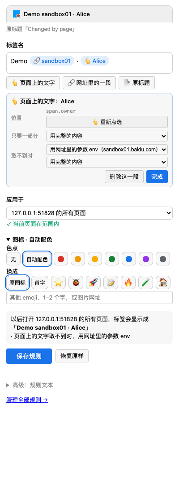

# tabmv

[English](README.md) · **简体中文**

一个给标签页改名、换图标颜色的 Chrome 扩展。标签名可以把自己写的文字、页面上的文字、网址里的任意一段和原标题自由组合；每一段在页面还没加载完、取不到时，都能先用别的内容顶上。匹配网址沿用 zsh / `zmv` 的 glob 写法，也支持正则。

```text
# 网址 http://host/app?id=3&env=sandbox01.baidu.com   →  标签显示 "sandbox01"，每个环境一个固定颜色
*[?&]env=(*).baidu.com* => {1} ; color=auto
```



## 解决什么问题

十个标签都叫“控制台”“订单详情”时，分不清哪个是测试环境、哪个是线上，哪个是哪张工单。tabmv 把你关心的那部分放进标签名：网址里的环境、页面上的工单号，或者给某个标签起个固定的名字。

## 安装

tabmv 暂时还没有上架 Chrome 应用商店，请从 Release 安装：

1. 在 [Releases](https://github.com/commiyou/tabmv/releases) 下载 `tabmv-<版本>.zip` 并解压（或者直接克隆本仓库）。
2. 打开 `chrome://extensions`，打开右上角的“开发者模式”。
3. 点“加载已解压的扩展程序”，选择解压出来的文件夹。

需要 Chrome 116 或更新版本。升级时把新版本解压覆盖到原来的文件夹，在扩展卡片上点刷新按钮，再把已经打开的标签刷新一次。

## 一分钟上手

1. 打开任意网页，点工具栏上的 tabmv 图标（或按 `Alt+Shift+R`），右侧会打开侧边栏。
2. 在**标签名**里直接打字；或者插入一段内容：**👆 页面上的文字**（然后去页面上点一下）、**🔗 网址里的一段**（然后点要用的那段）、**📄 原标题**。
3. 点一下插入的小块，可以只保留其中一部分（比如「.」前面），也可以设置**取不到时**用什么。
4. 选择**应用于**：只这个标签、这个网站、这个路径，或者任何带某个参数的网址。
5. 点**保存规则**。顶部会一直显示保存后标签的样子。

[新手教程](docs/tutorial.zh-CN.md)用五个实际例子一步步讲，每一步都有截图。

## 规则文本

侧边栏保存的是一行普通文本，可以在规则页（侧边栏底部“管理全部规则”）批量编辑、复制分享：

```text
网址匹配 => 标签名 [; icon=…] [; color=…]
```

```text
*://*.baidu.com/*        => {?env before "."}                                # 网址参数
*://*.baidu.com/*        => [{page ".env-name" or ?env before "."}] {title}   # 页面文字，没加载出来时用网址
*://jira.x/browse/*      => {page "h1" match /([A-Z]+-\d+)/ or path[2]} ; icon=🐞
```

| 标签名里的写法 | 含义 |
| --- | --- |
| `{page ".css"}` | 页面上第一个匹配元素的文字 |
| `{?env}` `{host[1]}` `{path[2]}` | 网址参数、域名第 1 段、路径第 2 段 |
| `{title}` `{1}` | 原标题、网址匹配里第 1 个 `(*)` |
| `A or B or "文字"` | 前一个取不到就用后一个 |
| `before "."` `after "-"` `match /re/` | 只保留一部分 |

完整语法见[教程第 5 节](docs/tutorial.zh-CN.md#5-规则文本)和规则页底部的说明。

## 隐私

tabmv 没有服务器，不向任何地方发送数据。规则保存在 `chrome.storage.sync`，由 Chrome 在你自己的设备之间同步。详见 [PRIVACY.md](PRIVACY.md)。

## 开发

```sh
npm ci
npm test            # 规则引擎单元测试，只需要 Node
npm run check       # 语法和 JSON 检查
npm run build       # 生成 dist/tabmv-<版本>.zip
CHROME=".../Google Chrome for Testing" npm run e2e   # 在真实浏览器里测试
```

浏览器测试要用 Chrome for Testing（`npx @puppeteer/browsers install chrome@stable`），因为正式版 Chrome 已经不支持 `--load-extension`。设置 `E2E_LANG=zh-CN` 可以用中文界面跑。

- [代码导读](docs/architecture.zh-CN.md)：给新加入的开发者串讲整个仓库。
- [发布流程](docs/publishing.zh-CN.md)：GitHub Actions、Release 和 Chrome 应用商店。
- [更新记录](CHANGELOG.md)

## 许可证

[MIT](LICENSE)
