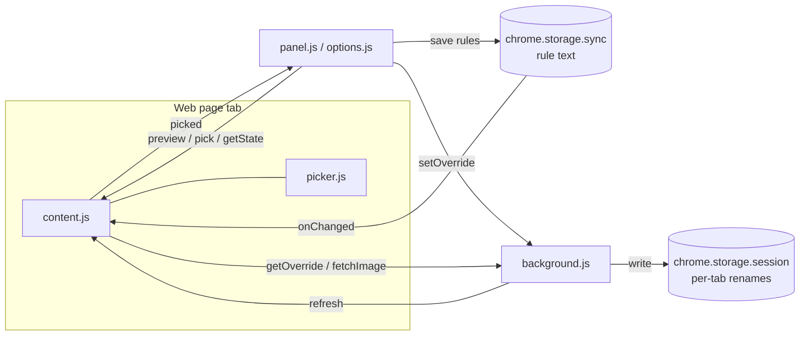

# How the code fits together

**English** · [简体中文](architecture.zh-CN.md)

A walk-through of the repo for new contributors: what each file does, which code a rename passes through, and the pitfalls we already hit. After reading it you should be able to add a feature.

## Overview

There is no build step; the browser loads the files in `src/` as they are.

```text
manifest.json          extension manifest (MV3)
_locales/{en,zh_CN}/   UI text, picked by browser language
icons/                 icons (icon.svg is the source; scripts/icons.cjs renders the PNGs)
src/
  rules.js             rule engine: pure functions, shared everywhere, tested in Node
  store.js             reads and writes the rule text (chrome.storage.sync, chunked)
  content.js           runs in each page: evaluates rules, sets title and icon, keeps them
  picker.js            element picker on the page; also reads element text
  background.js        service worker: per-tab renames, icon fetching, page notifications
  panel.html/js/css    side panel: the editor for everyday users
  options.html/js      rules page: for editing many rules at once
  i18n.js / ui.css     UI text helpers, shared styles
tests/rules.test.js    rule engine unit tests
scripts/               e2e, packaging, icons, store publishing
```



Two ideas hold it together:

1. **A rule is one line of text.** The panel, the rules page, sync and sharing all use the same text. `rules.js` turns it into something executable and can turn it back into text.
2. **Only content.js changes pages.** Everything else either writes rules or asks content.js to try a rule on the live page (preview).

## rules.js: the rule engine

It exports to the browser (`globalThis.TabRules`) and to Node (`module.exports`), so it never touches `chrome.*`.

For a line `URL match => tab name ; icon=… ; color=…`:

1. `parseRules(text)` splits lines, skips blanks and `#` comments, and compiles each line with `compileRule`. Failing lines go to `errors`, which the rules page shows.
2. `compileRule` finds ` => `, compiles the left side with `compilePattern`, splits the right side on unescaped `;`, and compiles the name, `icon=` and `color=` with `compileTemplate`. The original text stays in `rule.raw` so the panel can load a rule back for editing.
3. `compilePattern` turns `/…/flags` into a `RegExp` and hands everything else to `compileGlob`, which compiles a zsh-style glob into an anchored regex. `*` becomes the lazy `[\s\S]*?`, so `*env=(*).baidu.com*` captures the first `env`. Without `( )`, every wildcard captures, as in `zmv -W`.
4. `compileTemplate` compiles the tab name into an array: strings are output as is, and `{…}` becomes `{alts: [...]}`, the sources joined by `or`, each with its own `filters` (before, after, match, replace, …). The older `$1` and `${…}` forms compile to the same structure.
5. `evaluate(rules, page)` finds the first matching rule and `renderRule` renders it. Each `{…}` tries its `alts` in order and the first non-empty one wins; which one won is recorded in `trace` (that is where the panel's amber pieces come from).

`templateText` / `tokenText` go the other way and write the structure back as `{page ".x" or ?env}`. The panel saves with them, so the unit tests check that writing back and compiling again gives the same text.

One detail matters a lot: rendered titles are **stripped and whitespace-collapsed the way `document.title` is**. Otherwise `Mine {page ".x"}` renders `Mine ` when the piece is empty, the browser reports `Mine`, content.js thinks the page changed it and writes again, forever, which froze pages before v1.0.

## content.js: working inside the page

The manifest injects it at `document_start` together with `rules.js`, `store.js` and `picker.js`.

A rename goes like this:

1. **Take over**: it first dispatches a `tabmv:takeover` event. After an extension update or reload, the old script keeps running in open pages ("orphaned"); on this event it restores the title and stops, so two copies never fight over the title.
2. **load**: read the rule text, ask background for this tab's own rename (`getOverride`), compile.
3. **apply**: `compute()` evaluates, then sets `document.title` and calls `applyIcon`. `pageTitle` always holds the page's own title; `{title}` uses it, so prefixes never stack up.
4. **Keep it**: a MutationObserver on `<head>` re-applies on the next macrotask when the page changes its title or icon. A macrotask, so a page that fights back cannot trap us in a microtask loop; `mayWrite()` adds a limit of 15 writes in 2 seconds, then pauses for 10 seconds.
5. **Page text**: when a rule reads `{page …}`, `select()` remembers which elements it read. Only body insertions/removals and text changes inside those elements are observed, and recomputing happens at most every 300 ms. While an element does not exist yet, `{page …}` is empty and the source after `or` is used.

Icons: `drawIcon` draws an emoji, a letter tile, or the original icon plus a dot on a canvas. The original icon may be cross-origin, which would taint the canvas, so background fetches it with the extension's permissions and returns a data URL.

content.js also answers the panel: `getState`, `preview` (evaluate a rule on the live page without changing it), `pick` / `stopPick`.

## picker.js: picking and reading text

`start()` covers the page with a Shadow DOM overlay, outlines the element under the mouse, and on click builds a selector with `selectorFor()` and sends `{type: 'picked'}` to the panel. Selectors prefer stable things (`id`, `data-testid`, `aria-label`), skip generated classes like `css-1x2y3z`, and add `:nth-of-type` only when needed.

`textOf()` reads at most ~300 characters with a TreeWalker. `innerText` would force layout and copy the whole subtree, which is slow on big containers.

## background.js

- Per-tab renames live in `chrome.storage.session` under `ov:<tabId>`: they survive reloads and are removed when the tab closes.
- `fetchImage` fetches cross-origin icons.
- `tabs.onUpdated` notifies the page when the URL changes (SPA `pushState` does not re-inject scripts).
- The toolbar icon opens the side panel; `Alt+Shift+R` calls `sidePanel.open`. A side panel instead of a popup, because a popup closes as soon as you click the page, which makes picking impossible.
- On install or update it injects the scripts into tabs that are already open.

## panel.js: the side panel

The panel's state is the DOM of the tab name field: text nodes plus `.tk` pieces whose `data-id` points into `tokens`, each holding an `alts` array in the same shape as rules.js uses.

- `serialize()` writes the field as template text and `loadComposer()` does the reverse. When a tab is controlled by a rule, `loadTab()` loads `rule.raw`, and saving updates that line.
- Clicking a piece opens `renderCard()`: source, keep part (the first before/after/match filter), if missing (`alts[1]`).
- Each **Apply to** option maps to a URL match (`patternFor`); `classify` maps a saved pattern back to an option.
- All previews go to content.js `preview` and run on the live page, so page text, fallbacks and icons look exactly as they will after saving.

## store.js, options.js, i18n.js

- `store.js` stores the rule text in 1500-character chunks in `storage.sync` (8 KB per item limit) with one `set`, then removes leftover chunks. Before anything is saved it returns an example made only of comments.
- `options.js`: text box, per-line errors, a URL tester, and a preview of open tabs. After saving it reads the text back and reports how many rules are active and which lines have errors.
- `i18n.js`: `t(key, ...)` returns text and `localize()` fills elements with `data-i18n*` attributes. New UI text goes into both `_locales/*/messages.json`; `npm run build` checks that the keys match.

## Tests

- `npm test`: the rule engine, Node only. Add a case here first when you change the syntax.
- `npm run e2e`: loads the extension in Chrome for Testing and drives real pages: late-rendered elements, pages changing their title, SPA navigation, per-tab renames, saving on the rules page, re-injection takeover, no loop on whitespace, no freeze when a page fights back, and the panel's compose / fallback / load-back flow. `E2E_LANG=zh-CN` runs the Chinese UI; `SHOTS=dir` also writes the docs screenshots.
- CI runs both languages on Linux.

## Adding a feature: a new source

Say you want `{cookie "name"}`:

1. `rules.js`: recognize `cookie` in `source()` inside `parseV2Token`, read the value in `lookup()` (from a function passed in `ctx`, to stay pure), write it back in `altText()`, and allow it in `checkVars`.
2. `tests/rules.test.js`: cases for parsing, rendering and writing back.
3. `content.js`: provide the cookie reader when building `page`.
4. `panel.js`: give it a name and icon in `describeAlt` / `iconOf`, and an insert button if needed; add the text to both `messages.json`.
5. `scripts/e2e.cjs`: a check on a real page.

## Publishing

See [Publishing](publishing.md).
