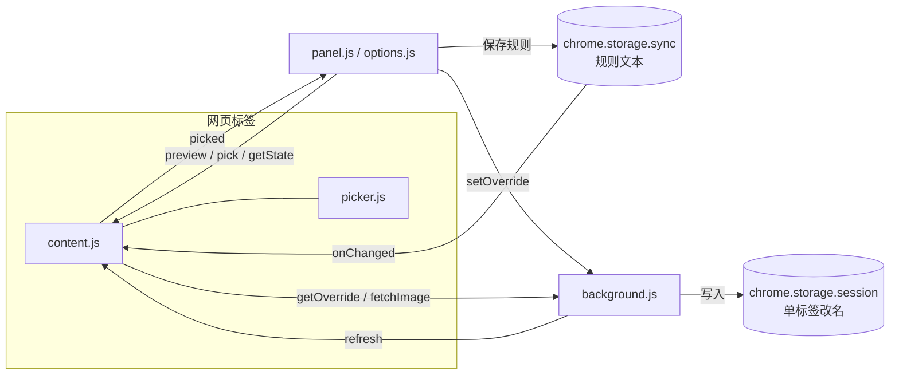

# 代码导读

[English](architecture.md) · **简体中文**

这篇文章带新加入的开发者把整个仓库串一遍：每个文件做什么、一次改名从头到尾经过哪些代码、踩过哪些坑。读完应该能自己加一个新功能。

## 全景

扩展没有构建步骤，`src/` 里的文件就是浏览器直接加载的文件。

```text
manifest.json          扩展清单（MV3）
_locales/{en,zh_CN}/   界面文字，浏览器按语言自动选
icons/                 图标（icon.svg 是源文件，PNG 由 scripts/icons.cjs 生成）
src/
  rules.js             规则引擎：纯函数，所有地方共用，也在 Node 里测试
  store.js             规则文本的读写（chrome.storage.sync，分块）
  content.js           页面里的执行者：求值、改标题和图标、保持住
  picker.js            页面上的元素点选器，也负责读取元素文字
  background.js        service worker：单标签改名、代取图标、通知页面
  panel.html/js/css    侧边栏：给普通用户用的编辑器
  options.html/js      规则页：给批量编辑的人用
  i18n.js / ui.css     界面文字工具、公共样式
tests/rules.test.js    规则引擎单元测试
scripts/               e2e、打包、图标、发布到商店
```



核心想法只有两条：

1. **规则就是一行文本**。侧边栏、规则页、同步、分享用的都是同一份文本，`rules.js` 负责把它变成可执行的结构，也能变回文本。
2. **真正改页面的只有 content.js**。其他部分要么写规则，要么让 content.js 在真实页面上试算一下（预览）。

## rules.js：规则引擎

文件末尾同时导出给浏览器（`globalThis.TabRules`）和 Node（`module.exports`），所以没有任何 `chrome.*` 调用。

一行规则 `网址匹配 => 标签名 ; icon=… ; color=…` 的处理顺序：

1. `parseRules(text)` 按行切开，跳过空行和 `#` 注释，每行交给 `compileRule`，出错的行收集到 `errors` 里（规则页显示的就是它）。
2. `compileRule` 找到 ` => `，左边交给 `compilePattern`，右边按未转义的 `;` 切开，标签名和 `icon=` / `color=` 各自交给 `compileTemplate`。原始文本留在 `rule.raw`，侧边栏靠它把规则读回来编辑。
3. `compilePattern`：`/…/flags` 直接变成 `RegExp`；其余交给 `compileGlob`，把 zsh 风格的 glob 编译成锚定的正则。`*` 编译成非贪婪的 `[\s\S]*?`，这样 `*env=(*).baidu.com*` 取到的是第一个 env。没有 `( )` 时每个通配符自动成为捕获组，对应 `zmv -W`。
4. `compileTemplate` 把标签名编译成一个数组：字符串原样输出，`{…}` 编译成 `{alts: [...]}`。`alts` 是 `or` 连起来的几个来源，每个来源带自己的 `filters`（before / after / match / replace…）。旧的 `$1`、`${…}` 写法也编译成同样的结构。
5. `evaluate(rules, page)` 从上到下找第一条匹配的规则，`renderRule` 把模板渲染出来：每个 `{…}` 依次试 `alts`，第一个非空的生效，用了第几个记在 `trace` 里（侧边栏的橙色小块就来自这里）。

`templateText` / `tokenText` 是反方向：把编译后的结构写回 `{page ".x" or ?env}` 这样的文本。侧边栏保存时用它，所以单元测试里有“写回去再编译一遍结果不变”的检查。

有一处细节很重要：渲染出的标题会**按 `document.title` 的规则去掉首尾空白、合并连续空白**。不这样做的话，`Mine {page ".x"}` 在取不到时得到 `Mine `，浏览器读回来是 `Mine`，content.js 以为被页面改掉了又写一次，无限循环把页面卡死（v1.0 之前的真实 bug）。

## content.js：在页面里干活

manifest 让它在每个页面 `document_start` 时注入，和 `rules.js`、`store.js`、`picker.js` 共用一个隔离环境。

一次改名的过程：

1. **接管**：一开始派发 `tabmv:takeover` 事件（这类内部标识和 `data-tabmv` 沿用项目最早的名字 tabmv，这样旧版本的脚本也认得）。扩展更新或重新加载后，旧版本的脚本还留在页面里（“孤儿”脚本），它收到事件就把标题还原并停止工作，避免两份脚本抢着改标题。
2. **load**：读规则文本、向 background 要这个标签的单独改名（`getOverride`），编译好。
3. **apply**：`compute()` 求值，然后写 `document.title`、调 `applyIcon`。`pageTitle` 始终记着页面自己的标题，`{title}` 用的是它，所以加前缀不会越叠越长。
4. **保持**：`<head>` 上的 MutationObserver 发现页面改了标题或图标，就在下一个宏任务里重新 apply。用宏任务而不是微任务，是为了即使页面和我们抢，也不会把页面卡在一个微任务循环里；`mayWrite()` 再兜一层：2 秒内写超过 15 次就暂停 10 秒。
5. **页面文字**：规则用到 `{page …}` 时，`select()` 记下读过哪些元素。之后只监听 body 的增删节点和这些元素自己的文字变化，变化后最多每 300ms 重算一次。元素还不存在时 `{page …}` 取不到，自然落到 `or` 后面的来源。

图标：`drawIcon` 在 canvas 上画 emoji、首字方块或原图标加色点。原图标可能跨域，直接画会污染 canvas，所以交给 background 用扩展权限取回来，转成 data URL 再画。

content.js 还响应侧边栏的消息：`getState`（当前状态）、`preview`（在真实页面上试算一条规则，不改页面）、`pick` / `stopPick`（点选）。

## picker.js：点选和读文字

`start()` 在页面上盖一层 Shadow DOM 遮罩，鼠标下的元素加蓝框，点击时用 `selectorFor()` 生成选择器，通过 `runtime.sendMessage({type:'picked'})` 发给侧边栏。选择器优先用稳定的东西：`id`、`data-testid`、`aria-label`，跳过 `css-1x2y3z` 这类构建工具生成的 class，必要时才加 `:nth-of-type`。

`textOf()` 用 TreeWalker 最多读约 300 个字。不用 `innerText`，因为它会强制排版并复制整个子树，在大容器上很慢。

## background.js：后台

- 单标签改名存在 `chrome.storage.session`，键是 `ov:<tabId>`：刷新后还在，关掉标签就清掉。
- `fetchImage`：代取跨域图标。
- `tabs.onUpdated` 发现网址变了（单页应用的 pushState 不会重新注入脚本）就通知页面重算。
- 点图标打开侧边栏；快捷键 `Alt+Shift+R` 调 `sidePanel.open`。用侧边栏而不是弹窗，是因为弹窗在页面上点一下就关了，没法点选。
- 安装或更新时把脚本注入已经打开的标签。

## panel.js：侧边栏

侧边栏的状态就是“标签名输入框里的 DOM”：文字节点加上 `.tk` 小块，每个小块的 `data-id` 对应 `tokens` 里一份 `alts`（和 rules.js 里的结构一样）。

- `serialize()` 把输入框写成模板文本，`loadComposer()` 反过来把模板变成小块。打开一个已由规则控制的标签时，`loadTab()` 用 `rule.raw` 把规则载入，保存就是更新那一行。
- 点小块打开 `renderCard()`：来源、只要一部分（改 `filters` 里第一个 before/after/match）、取不到时（改 `alts[1]`）。
- **应用于**的每个选项对应一个网址匹配（`patternFor`）；读回规则时用 `classify` 反查是哪个选项。
- 所有预览都发给 content.js 的 `preview` 在真实页面上算，所以页面文字、兜底、图标都和保存后一致。

## store.js、options.js、i18n.js

- `store.js`：规则文本按 1500 字一块存进 `storage.sync`（单项上限 8KB），一次 `set` 写完，再删多余的块。没保存过时返回一份全是注释的示例。
- `options.js`：文本框 + 逐行报错 + 测试框 + 已打开标签预览。保存后读回来比对，再报告生效了几条、哪几行有错。
- `i18n.js`：`t(key, ...)` 取文字，`localize()` 填充带 `data-i18n*` 属性的元素。新增界面文字时，两个 `_locales/*/messages.json` 都要加，`npm run build` 会检查两边的键一致。

## 测试

- `npm test`：规则引擎，只需要 Node。改语法时先在这里加用例。
- `npm run e2e`：用 Chrome for Testing 加载扩展，跑真实页面：晚渲染的元素、页面改标题、单页应用跳转、单标签改名、规则页保存、重复注入接管、空白不循环、页面抢标题不卡死、侧边栏组合/兜底/读回编辑。`E2E_LANG=zh-CN` 用中文界面跑，`SHOTS=dir` 顺便生成文档截图。
- CI 在 Linux 上用英文和中文各跑一遍。

## 加一个新功能：以“新的来源”为例

比如想支持 `{cookie "name"}`：

1. `rules.js`：在 `parseV2Token` 的 `source()` 里认出 `cookie`，在 `lookup()` 里取值（值由调用方通过 `ctx` 提供，保持纯函数），在 `altText()` 里写回文本，`checkVars` 放行。
2. `tests/rules.test.js`：加解析、渲染、写回的用例。
3. `content.js`：在构造 `page` 时提供取 cookie 的函数。
4. `panel.js`：在 `describeAlt` / `iconOf` 里给它一个名字和图标，需要的话加一个插入按钮；文字加到两份 `messages.json`。
5. `scripts/e2e.cjs`：加一个真实页面上的检查。

## 发布

见 [发布流程](publishing.zh-CN.md)。
