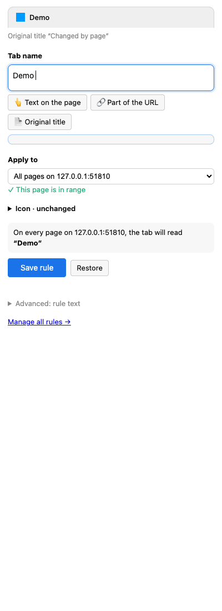
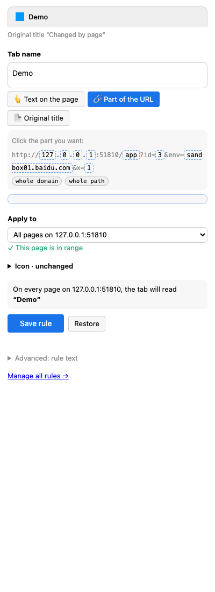
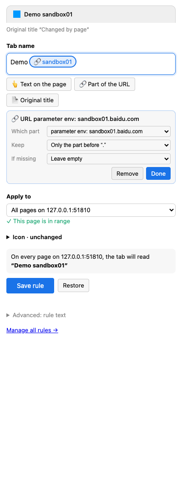
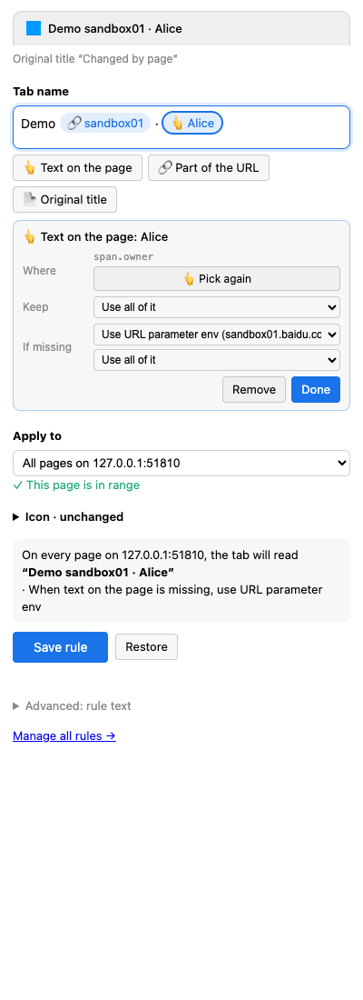
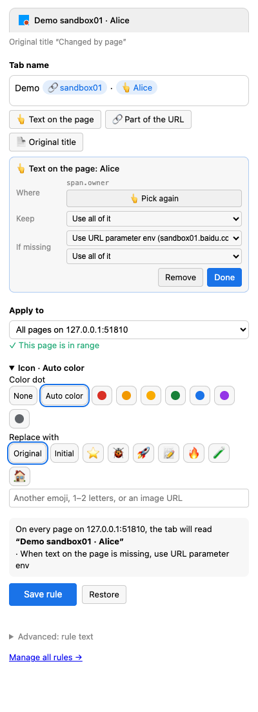
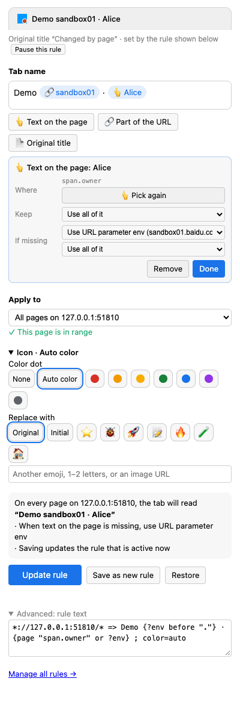
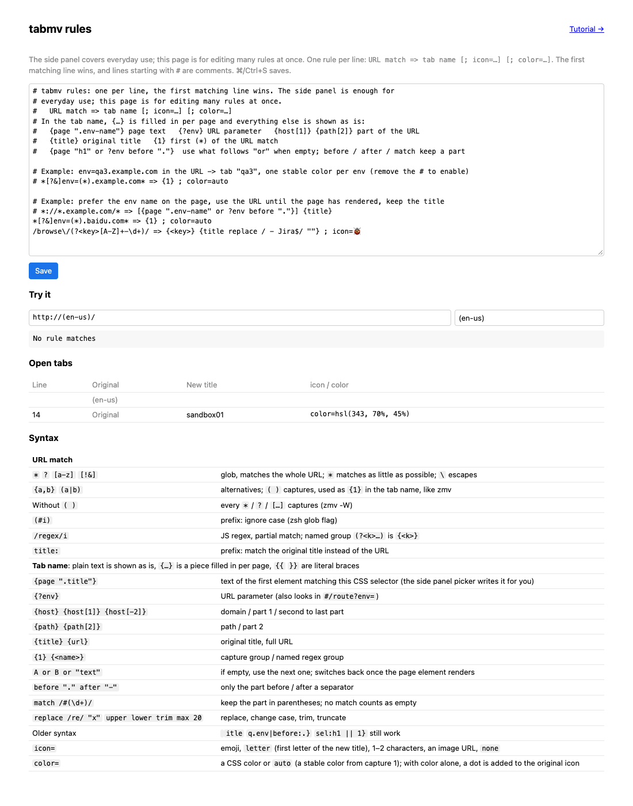

# tabmv tutorial

**English** · [简体中文](tutorial.zh-CN.md)

Five short examples take you from "rename one tab" to "write rules by hand". After them you can read any line on the rules page.

## 0. Setup

1. Install the extension (see the [README](../README.md#install)).
2. Open a normal web page. Browser settings and the Web Store cannot be changed by extensions; the panel tells you when you are on such a page.
3. Click the tabmv icon or press `Alt+Shift+R`. The side panel opens.

From top to bottom the panel shows:

- **Preview**: how the tab will look after saving, updated as you edit. The small line below it says what controls the tab now.
- **Tab name**: a field where you type text and insert pieces.
- **Apply to**: which pages get this name.
- **Icon** (collapsed): add a color dot or swap the icon.
- One sentence describing what saving will do, and the **Save** button.

## 1. Name one tab

You have two identical admin pages open and want to call one of them "Demo".

1. Type `Demo` into **Tab name**.
2. Set **Apply to** to "Only this tab (until it is closed)".
3. Click **Rename this tab**.



The name survives reloads and disappears when you close the tab. To apply a name automatically in the future, pick a wider range as in the next examples.

## 2. Use part of the URL

Your test environment URLs look like `http://host/app?id=3&env=sandbox01.baidu.com` and you want the tab to say `sandbox01`.

1. Click **🔗 Part of the URL**. The URL is split into parts you can click.

   

2. Click `sandbox01.baidu.com` after `env=`. A blue piece appears in the tab name showing its current value, and its settings open below.
3. Under **Keep**, choose "Only the part before “.”". The piece now reads `sandbox01`.

   

4. Leave **Apply to** at "All pages on …" and click **Save rule**.

Every page on that site now shows the part of `env` before the first dot. tabmv finds the parameter by name, so its position in the URL does not matter.

> Mix pieces and text freely: type `[` before a piece and `] ` after it to get names like `[sandbox01] Original title`.

## 3. Use text on the page, with the URL as a fallback

The page shows the environment owner "Alice" and you want that as the tab name. The page loads slowly, so the text is missing for the first second.

1. Click **👆 Text on the page**. The button turns red while picking.
2. Move the mouse over the text on the page; it gets a blue outline. Click it. `↑` selects a larger area, `↓` a smaller one, `Esc` cancels. You can also select text with the mouse first and then click the button.
3. A 👆 piece appears. In its settings, set **If missing** to "Use URL parameter env".



What happens:

- While the page is loading and the text is not there yet, the tab shows `env` from the URL.
- As soon as the text appears, the tab switches to it.
- If a redesign removes the text, the tab falls back to the URL instead of going blank.

A piece turns **amber** while it shows its fallback (hover for the reason) and grey when nothing is available.

## 4. Icons and colors

Open **Icon**:

- **Color dot** adds a dot to the site's own icon, so the site stays recognizable. "Auto color" derives the color from the content: `sandbox01` always gets the same color and `sandbox02` a different one.
- **Replace with** swaps the icon for an emoji, the first letter of the title, or an image URL.



## 5. Rule text

Every save writes one line of text. Open **Advanced: rule text** at the bottom to see it:



**Manage all rules** opens the rules page, where you can edit every rule at once, try any URL, and preview what all open tabs will become.



A rule line looks like this:

```text
URL match => tab name [; icon=…] [; color=…]
```

Rules are tried from top to bottom and **the first match wins**. Lines starting with `#` are comments; adding `#` in front of a rule pauses it (that is what "Pause this rule" does).

### URL match

A glob by default, which must match the whole URL. Wrap it in `/…/` for a regular expression, which may match any part.

| Syntax | Means |
| --- | --- |
| `*` | any run of characters (as short as possible) |
| `?` `[abc]` `[!&]` | any one character / one of these / none of these |
| `{dev,qa}` `(dev\|qa)` | either one |
| `(*)` | capture, used as `{1}` `{2}` in the tab name |
| leading `(#i)` | ignore case |
| `/…/i` | regex; named group `(?<key>…)` is `{<key>}` |
| leading `title:` | match the original title instead of the URL |

Chrome match patterns such as `*://*.baidu.com/*` are valid globs too.

### Tab name

Plain text is shown as is; `{…}` is a piece filled in per page. Write `{{` and `}}` for literal braces.

| Syntax | Means |
| --- | --- |
| `{page ".env-name"}` | text of the first element matching this CSS selector |
| `{?env}` | URL parameter `env` (also found in `#/route?env=`) |
| `{host}` `{host[1]}` `{host[-2]}` | domain / part 1 / second to last part |
| `{path}` `{path[2]}` | path / part 2 |
| `{title}` `{url}` | original title / full URL |
| `{1}` `{<key>}` | captures from the URL match |
| `A or B or "text"` | use the next one when the previous is empty |
| `before "."` `after "-"` | only the part before / after a separator |
| `match /#(\d+)/` | keep the part in parentheses; no match counts as empty |
| `replace /re/ "x"` `upper` `lower` `trim` `max 20` | replace, change case, trim, truncate |

`icon=` takes an emoji, `letter` (first letter of the new title), one or two characters, an image URL, or `none`. `color=` takes a CSS color or `auto`.

### If you know zmv

Rules read like zsh's `zmv`: a pattern with `(*)` on the left, numbered references on the right.

```sh
zmv '(*)-(*).mp3' '$2 - $1.mp3'
```

```text
*://(*).example.com/(*)/* => {2} - {1}
```

Without parentheses every `*` captures, like `zmv -W`: `https://*.x.com/*/issues/* => {2}#{3}`.

## FAQ

**I saved, but the tab did not change.** Read the check under **Apply to**: "This page is outside the range" means the rule does not cover this URL. If you just updated or reloaded the extension, reload the open tabs once.

**Two rules match. Which one wins?** The one higher on the rules page. Rules created in the panel go to the top.

**How do I turn a rule off?** Click "Pause this rule" in the panel, or put `#` in front of it on the rules page.

**The page keeps changing its own title.** tabmv changes it back, and if the page rewrites it more than about 15 times in 2 seconds, tabmv pauses for 10 seconds instead of fighting.

**How do I share or back up rules?** The text box on the rules page holds all of them; copy it. Chrome syncs rules between devices signed in to the same account.
