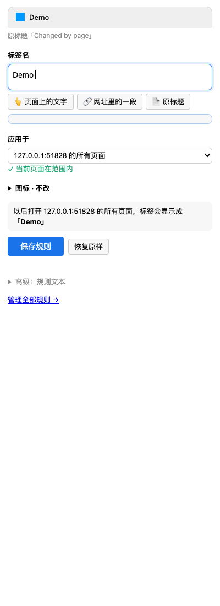
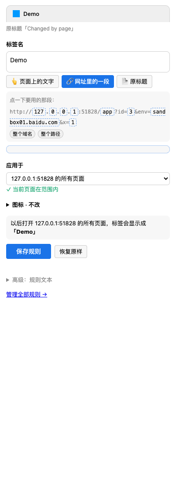
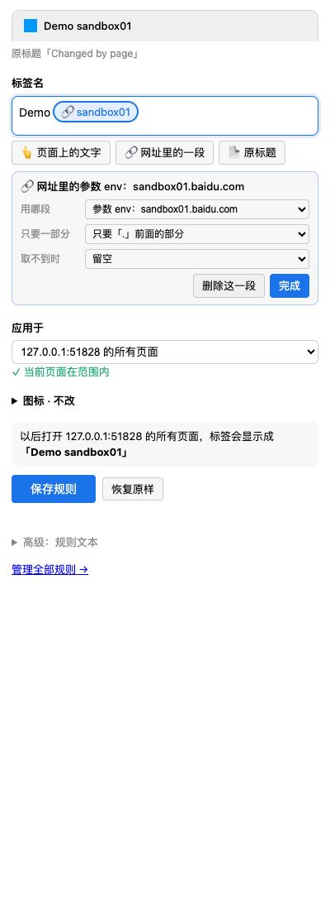
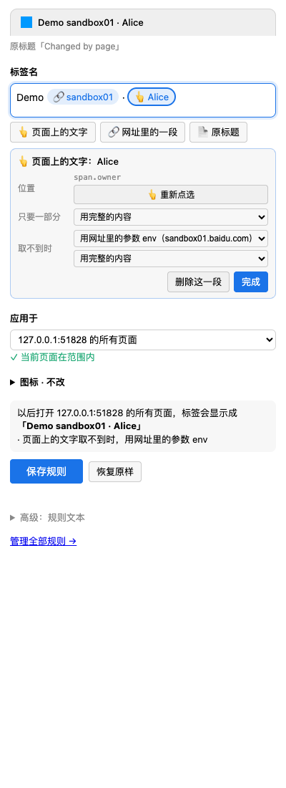
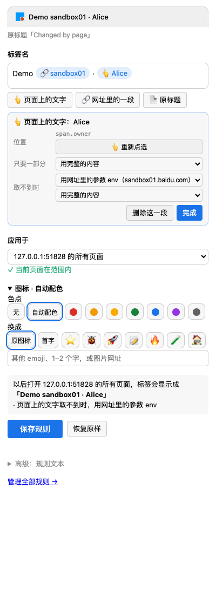
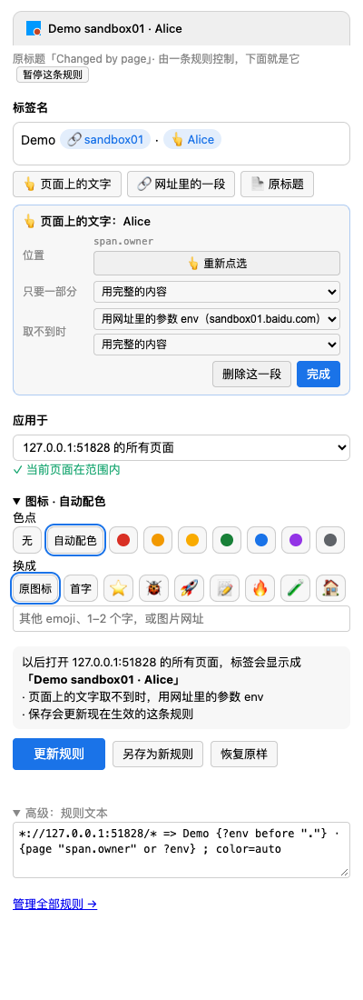
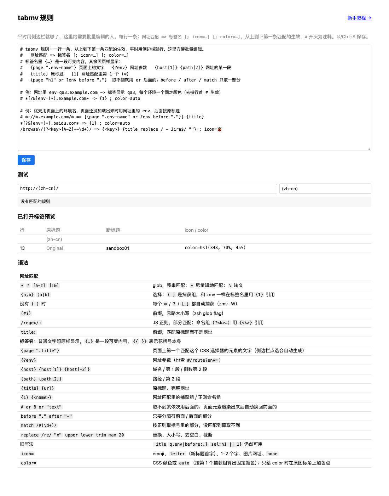

# tabmv 新手教程

[English](tutorial.md) · **简体中文**

这篇教程用五个例子带你从“给一个标签起名字”一直做到“自己写规则”。每个例子几分钟，做完就能看懂规则页里的任何一行。

## 0. 准备

1. 安装扩展（见 [README](../README.zh-CN.md#安装)）。
2. 打开一个普通网页。浏览器设置页、扩展商店这类页面不允许扩展修改，侧边栏会提示你换一个页面。
3. 点工具栏上的 tabmv 图标，或按 `Alt+Shift+R`，右侧打开侧边栏。

侧边栏从上到下是：

- **预览**：保存后标签会长什么样，随你的修改实时变化。下面一行小字说明这个标签现在的状态（原标题、是否已有规则在控制它）。
- **标签名**：一个输入框，可以打字，也可以插入“可变内容”。
- **应用于**：这个名字用在哪些页面。
- **图标**（可折叠）：加色点、换 emoji。
- 一句话说明保存后会发生什么，和**保存**按钮。

## 1. 给一个标签起名字

场景：开了两个一样的后台页面，想把其中一个叫 “Demo”。

1. 在**标签名**里输入 `Demo`。
2. **应用于**选“只这个标签（关掉就失效）”。
3. 点**只改这个标签**。



“只这个标签”的名字刷新页面后还在，关掉标签就没了，也不会影响其他页面。想要以后自动生效，就像下面几个例子一样选一个范围。

## 2. 用网址里的一段

场景：测试环境的网址长这样 `http://host/app?id=3&env=sandbox01.baidu.com`，想让标签直接显示 `sandbox01`。

1. 点 **🔗 网址里的一段**。网址会被拆开显示，每一段都可以点。

   

2. 点 `env=` 后面的 `sandbox01.baidu.com`。标签名里多了一个蓝色小块，显示它现在的值。同时下方弹出这一段的设置。
3. 在**只要一部分**里选“只要「.」前面的部分”，小块就变成了 `sandbox01`。

   

4. **应用于**保持“xxx 的所有页面”，点**保存规则**。

以后打开这个网站的任何页面，标签都会显示 env 参数「.」前面的部分。参数在网址里的顺序变了也没关系，tabmv 按参数名找。

> 小块和文字可以随意组合：在小块前后打字，比如 `[`、`] `，就能得到 `[sandbox01] 原标题` 这样的名字。

## 3. 用页面上的文字，取不到时用网址

场景：页面右上角显示着环境名“Alice”，想用它当标签名；但这个页面加载慢，刚打开时还没有这段文字。

1. 点 **👆 页面上的文字**，按钮变红，表示正在点选。
2. 到页面上把鼠标移到那段文字上，它会被蓝框圈出来，点一下。按 `↑` 可以选更大的范围，`↓` 缩小，`Esc` 取消。也可以先用鼠标选中一段文字，再点这个按钮。
3. 标签名里出现一个 👆 小块，下方的设置里有一项**取不到时**，选“用网址里的参数 env”。



效果：

- 页面刚打开、那段文字还没出现时，标签先显示网址里的 env。
- 文字一出现，标签自动换成页面上的文字。
- 网站改版找不到那段文字时，也会用网址里的 env，不会变成空白。

正在用后备内容的小块会变成**橙色**，鼠标悬停能看到原因；灰色表示现在什么都取不到。

## 4. 图标和颜色

展开**图标**：

- **色点**：在原来的网站图标右下角加一个色点，网站还认得出来。选“自动配色”时，颜色由内容算出来：`sandbox01` 永远是同一种颜色，`sandbox02` 是另一种，一眼就能分清环境。
- **换成**：换成 emoji、标题的第一个字，或者自己填一个图片网址。



## 5. 规则文本

每次保存，侧边栏写下的都是一行普通文本。展开底部的**高级：规则文本**就能看到：



点**管理全部规则**打开规则页，可以一次编辑所有规则，下方能测试任意网址，还会预览所有打开的标签会变成什么样。



一行规则的结构：

```text
网址匹配 => 标签名 [; icon=…] [; color=…]
```

规则从上到下比较，**第一条匹配的生效**。`#` 开头的行是注释，在行首加 `#` 就能暂时停用一条规则（侧边栏里的“暂停这条规则”就是这么做的）。

### 网址匹配

默认是 glob，整个网址都要匹配上；用 `/…/` 包起来就是正则，匹配到一部分就行。

| 写法 | 含义 |
| --- | --- |
| `*` | 任意一串字符（尽量短） |
| `?` `[abc]` `[!&]` | 任意一个字符 / 其中一个 / 除了这些 |
| `{dev,qa}` `(dev\|qa)` | 二选一 |
| `(*)` | 捕获，在标签名里用 `{1}` `{2}` 引用 |
| `(#i)` 开头 | 忽略大小写 |
| `/…/i` | 正则；命名组 `(?<key>…)` 用 `{<key>}` 引用 |
| `title:` 开头 | 匹配原标题而不是网址 |

Chrome 的匹配模式（如 `*://*.baidu.com/*`）本身就是合法的 glob。

### 标签名

普通文字照原样显示，`{…}` 是一段可变内容。要显示花括号本身就写 `{{` `}}`。

| 写法 | 含义 |
| --- | --- |
| `{page ".env-name"}` | 页面上第一个匹配这个 CSS 选择器的元素的文字 |
| `{?env}` | 网址参数 env（也会查 `#/route?env=` 这种写法） |
| `{host}` `{host[1]}` `{host[-2]}` | 域名 / 第 1 段 / 倒数第 2 段 |
| `{path}` `{path[2]}` | 路径 / 第 2 段 |
| `{title}` `{url}` | 原标题 / 完整网址 |
| `{1}` `{<key>}` | 网址匹配里的捕获 |
| `A or B or "文字"` | 前一个取不到就用后一个 |
| `before "."` `after "-"` | 只要分隔符前面 / 后面的部分 |
| `match /#(\d+)/` | 按正则取括号里的部分；没匹配到算取不到 |
| `replace /re/ "x"` `upper` `lower` `trim` `max 20` | 替换、大小写、去空白、截断 |

`icon=` 可以是 emoji、`letter`（新标题的第一个字）、一两个字、图片网址或 `none`。`color=` 可以是 CSS 颜色或 `auto`。

### 和 zmv 的对应

如果你用过 zsh 的 `zmv`，规则读起来是一样的：左边是带 `(*)` 的模式，右边用编号引用捕获。

```sh
zmv '(*)-(*).mp3' '$2 - $1.mp3'
```

```text
*://(*).example.com/(*)/* => {2} - {1}
```

没有写括号时，每个 `*` 都自动成为捕获（对应 `zmv -W`）：`https://*.x.com/*/issues/* => {2}#{3}`。

## 常见问题

**保存了但标签没变？** 先看侧边栏的检查提示：“当前这个页面不在范围内”说明规则的范围没有覆盖这个网址。如果刚更新或重新加载过扩展，把已经打开的标签刷新一次。

**两条规则都能匹配，用哪条？** 用规则页里排在上面的那条。侧边栏新建的规则会放在最上面。

**怎么停用一条规则？** 侧边栏点“暂停这条规则”，或在规则页行首加 `#`。

**页面自己不停地改标题怎么办？** tabmv 会跟着改回来；如果页面 2 秒内改了十几次，tabmv 会暂停 10 秒，避免和页面一直抢。

**规则怎么分享、备份？** 规则页的文本框就是全部规则，复制出去就行。同一个 Chrome 账号登录的设备之间会自动同步。
